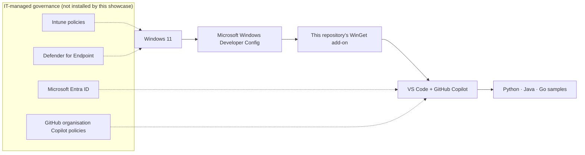

# Windows 11 developer workstation showcase

A repeatable, governed developer workstation built on Microsoft's Windows Developer Config, with VS Code and GitHub Copilot at the centre of daily work. The add-on brings Python, Java and Go samples, INR-aware financial calculations, declarative tooling and reusable agent workflows together. All sample data is synthetic; this is a development demonstration, not a production banking system.

> Community showcase, not an official Microsoft product. It builds on [Microsoft's official Windows Developer Config](https://github.com/microsoft/WindowsDeveloperConfig).

## Ready in 3 steps

After IT approval, clone the repository and open PowerShell at its root:

```powershell
.\scripts\bootstrap.ps1
```

1. **Microsoft base:** preflight runs first; bootstrap downloads the standard setup, requires a valid Microsoft Authenticode signature, then executes it. Save work before starting: elevation and a restart may be needed.
2. **This add-on:** apply the required WinGet configuration and verify tools and extensions. Microsoft's restart task resumes **only its base setup**. After it finishes, open a fresh terminal and run `.\scripts\bootstrap.ps1 -SkipBase` to finish this add-on.
3. **Sign in:** in VS Code, select the Copilot Status Bar icon → **Use AI Features**, using the organisation-approved GitHub account with an assigned Copilot Business or Enterprise seat. Run `az login` only when authorised to authenticate to Azure; authentication does not deploy resources.

See [Setup](docs/SETUP.md) before running any setup command. Java modernization is optional: `.\scripts\bootstrap.ps1 -SkipBase -IncludeJavaModernization`.

## What you get

| Layer | Contents |
| --- | --- |
| Microsoft base | Terminal, PowerShell, Git, GitHub CLI and Copilot CLI, VS Code, .NET SDK, Python + uv, Node.js + nvm, Windows utilities, Azure CLI, WSL + Ubuntu |
| Required add-on | Java, Go, Azure Developer CLI, kubectl; declarative checks for shared tooling |
| 12 required extensions | Python, Java pack, Go, Azure Resources, GitHub Copilot for Azure, Bicep, Container Tools, Dev Containers, Remote WSL, GitHub Pull Requests, PowerShell, YAML |
| Optional 13th recommendation | GitHub Copilot modernization; installed and required only with `-IncludeJavaModernization` |
| Samples | EMI API, IFSC validation, synthetic FX conversion; deliberately legacy Java modernization exercise |
| Agent workflows | Extend with tests, containerise, prepare Azure files without deployment, review standards |

Toolchain and dependency versions belong in the configurations and sample manifests, not duplicated documentation pins.

## Architecture



## Documentation

- [Setup and signed execution](docs/SETUP.md)
- [15-minute demo script and recovery](docs/DEMO-SCRIPT.md)
- [Troubleshooting](docs/TROUBLESHOOTING.md)
- [IT prerequisites and support boundaries](docs/IT-PREREQUISITES.md)
- [Windows and macOS comparison](docs/WINDOWS-VS-MAC.md)
- [Architecture and change lifecycle](docs/ARCHITECTURE.md)
- [Samples](samples/), [agent rules](AGENTS.md), [security policy](SECURITY.md), [MIT licence](LICENSE)

Validation output is evidence for the machine and revision where it ran, not a guarantee of enterprise policy compliance or production readiness.
