# Architecture and lifecycle

## Ownership

| Layer | Purpose / owner |
| --- | --- |
| Windows 11 and governance | IT-owned image, virtualization, App Installer, Intune, Defender and execution/network policies |
| Microsoft Windows Developer Config | Signed, resumable standard base; upstream trust/release lifecycle |
| `.config\configuration.winget` | Reviewed required tool/extension add-on; optional Java modernization profile remains separate |
| `.vscode\` and `scripts\developer.ps1` | VS Code tasks/integrated-terminal workflow: setup, explicit restore, daily checks, GitHub and operator actions |
| `.github\` / `AGENTS.md` | Bank instructions, customization, CI, PR template and manual deployment workflow; not permission to execute |
| Modern samples | Synthetic Python EMI, Java IFSC and Go FX; pinned runtimes/dependencies and tested contracts |
| Legacy sample | Java 11 / Spring Boot 2.7 opt-in modernization exercise; excluded from normal CI/deployment |
| Existing AKS + ACR | IT-owned identities, registry, cluster, precreated namespace, RBAC and runner networking |

Twelve extensions are required; the thirteenth modernization recommendation is optional. Recommendations and workspace settings do not enforce enterprise policy.

## Developer flow, entirely from VS Code

```mermaid
flowchart LR
  S["Setup once · human + IT"] --> R["Explicit project package restore"]
  R --> V["VS Code edit · test · lint · coverage"]
  V --> P["Branch · commit · publish · PR"]
  P --> C["GitHub modern-service CI"]
  C --> M["Reviewed main"]
  M --> D["Manual main-SHA dispatch"]
  D --> B["ACR build identity · immutable digests"]
  B --> A["Independent aks-demo approval"]
  A --> K["Deploy identity · existing AKS namespace"]
```

Fresh/partial approved laptops use installed-first modules after local inventory/source/policy review. Default bootstrap previews Core; explicit Apply installs only missing targets, never upgrades installed ones. SDKs/Extensions/WSL are independently retryable; unknown/incompatible inventory fails closed. Microsoft standard bundle is separately labelled legacy opt-in; only its confirmed successful base/reboot/resume permits LegacyMicrosoftBundle + SkipBase. Setup never authenticates, restores project packages, runs services or deploys.

Restore is a separate user-approved package/network action. Daily Test/Lint/Coverage requires already installed/restored dependencies and does not automatically fix missing tools. Reports are Python JUnit/XML/HTML, Java Surefire/JaCoCo, Go JSON/coverage and PowerShell Pester XML; see [Setup](SETUP.md).

Built-in VS Code Git handles clone/authentication/staging/commit/publish. The official GitHub Pull Requests extension adds PR/issue review. CI checks modern services and repository validation; observe actual results rather than treating a command list as passing evidence.

## Application boundaries

Main services expose `/health` and use sample-defined ports; the operator
launcher chooses the requested local/host port. Shared runtime selection is
`-Runtime Auto|wslc|docker`: Auto selects `wslc` first and considers `docker` only
if `wslc` is absent, not when blocked/broken. Explicit selection probes only the
approved chosen runtime and has no fallback. Never use selection to bypass
policy. Docker Desktop is a commented optional, licence-reviewed choice.
Local builds belong only to the separately confirmed Restore ContainerImages
target. RunContainer inspects an existing local image and uses `--pull=never`,
with no implicit build/pull/package restoration. Missing images mean NOT RUN.
Launch/restore are explicit user actions, not idempotent setup.

Monetary arithmetic uses Decimal/BigDecimal or exact rational/integer arithmetic with explicit half-up rounding and fixed two-decimal JSON strings; INR display uses lakh grouping. Baseline EMI totals multiply rounded EMI by tenure. The retained schedule exercise preserves EMI, applies one-time prepayment after the chosen regular installment, shortens tenure and settles the final balance exactly.

Revised main's Go service does not disclose raw query strings or internal error details. The unsafe review example is isolated in a **non-serving text fixture**, never reintroduced into an application or image.

## Existing-AKS cloud boundary

The [GitHub/AKS plan](GITHUB-AKS.md) replaces Container Apps/azd provisioning with application-only Kubernetes manifests and a manual delivery path to **existing** AKS/ACR. No cluster, registry, namespace, RBAC or ingress infrastructure is created by this repository.

Deployment verifies trusted current main SHA and live GitHub protections before OIDC; runs modern-service gates; builds/pushes with the separate registry identity; passes immutable digests through same-run outputs; waits for independent environment review; then rechecks and deploys with namespace-scoped rights and user kubeconfig/Entra kubelogin. Unavailable/unverifiable reviewer protections, including private-plan limitations, fail closed.

IT owns OIDC federation, actual subject-format verification, kubelet registry pulls, admission policy, registry permissions and network-connected private-cluster runners. Application Services are ClusterIP; user port-forward is the demo access path. Key Vault/workload identity requires a separate reviewed design if actual secrets are later needed; these synthetic services need no customer credentials.

## Adoption and safe fallback

Review a small PR with tests, configuration rationale and actual observed checks/skips. Required CI/review precedes merge; a push/PR never deploys. Only an explicitly dispatched current-main run can request deployment, and dispatch is not approval. Release/tag creation and workstation reconciliation are separate human actions.

Desired-state setup is designed for re-running but not an immutable snapshot: policy, upstream packages and resource tests can fail. Do not claim unconditional idempotency for setup, launch or reset.

The original `demo-baseline` tag is **historical and unsafe**, retained only for source history. Never launch, reset a runnable checkout to it or deploy it. Revised `main` is the safe baseline. Inspect `demo-complete` as the retained schedule fallback; it uses the same manual/main-only AKS pipeline and contains no old `azure.yaml`/Container Apps infrastructure. Verify actual refs/content rather than assuming they were created by setup or this documentation.

Recover using a separate reviewed clean checkout, preserving unrelated
staged/unstaged/untracked/unsaved work. The revised reset helper restores **only
samples from fetched safe `origin/main`**, freezes/rechecks the resolved commit
through confirmations and rejects the old unsafe Go handler. The user fetches
first through VS Code; neither reset nor an agent automatically fetches.
`demo-baseline` remains unchanged history; no new baseline tag is assumed.
See [the runbook](DEMO-SCRIPT.md#recovery-without-losing-unrelated-work).
