# GitHub Actions → existing AKS + ACR

This is an **application deployment plan and operator guide**, not a cluster-provisioning script. IT supplies an existing Azure Kubernetes Service cluster, Azure Container Registry, identities, namespace, RBAC and network-connected runner. Repository preparation creates none of them. No agent authenticates, dispatches, provisions or deploys.

## Delivery flow

```mermaid
flowchart LR
  V["VS Code branch · tests · PR"] --> C["GitHub CI · modern services"]
  C --> M["Reviewed main"]
  M --> D["Human workflow_dispatch · exact source_sha"]
  D --> G["Verify live environment protections"]
  G --> T["Run modern-service CI gates"]
  T --> B["Build identity · ACR push"]
  B --> I["Same-run immutable digests"]
  I --> A["aks-demo · independent approval"]
  A --> R["Recheck protections and source"]
  R --> K["Deploy identity · existing namespace"]
  K --> H["Rollout · probes · health"]
```



`.github\workflows\deploy-aks.yml` is **manual `workflow_dispatch` only**, from trusted `main`. No PR, push, tag, historical baseline or fallback branch can deploy. Its required `source_sha` must equal both the dispatch revision and current remote `main`; if `main` moves before deployment, stop and start a new reviewed run.

The workflow uses reusable modern-service CI gates for Python, current Java and Go, with repository checks; legacy Java is excluded. Only successful gates permit the build identity to push all three application images. Tags include the source SHA, run and attempt rather than `latest`; deployment consumes registry **digests passed directly through same-run job outputs**, not a mutable tag or a hand-entered image.

Deployment waits for independent approval of `aks-demo`. It checks protections again before Azure OIDC, obtains **user**, never admin, kubeconfig, uses Entra `kubelogin`, applies only application objects in the existing namespace and checks rollout/probes/health. Static manifest checks do not prove a live deployment.

## Setup owned by IT / repository administrators

Complete and independently verify all of this **before** enabling deployment. Creating an environment by referencing its name in YAML can silently create an unprotected environment; that is not approval.

### 1. GitHub governance

From VS Code, open the repository's GitHub page using the GitHub view, or use the integrated browser for repository administration. A repository administrator configures **Settings → Environments → aks-demo**:

- **Required reviewers**: approved person/team, with at least one reviewer independent of the initiator.
- **Prevent self-review**: enabled (`prevent_self_review=true`).
- **Allow administrators to bypass configured protection rules**: disabled (`can_admins_bypass=false`).
- **Deployment branches and tags → Selected branches and tags**: exactly one **Branch** rule for **`main`**, no tags or wildcard/PR rules.

Protect `main` with review and required CI checks. Restrict changes to workflows, validation scripts and deployment manifests using repository governance; an editable checker is not an independent security boundary.

**Private repository plan prerequisite:** GitHub's current documentation says required reviewers on Free, Pro and Team are public-repository-only. Pro/Team support for *creating* private environments does not imply support for independent review protection. Use a compatible GitHub Enterprise arrangement for private deployment and verify the actual feature/REST response with your administrator. If the required controls are unavailable, absent or unverifiable, **do not deploy**, do not downgrade to a bare manual dispatch and do not make a private repository public merely to obtain approval features.

`scripts\check_deployment.py` queries live environment/branch protection configuration with the workflow `GITHUB_TOKEN` before Azure OIDC and fails closed when it cannot verify the required controls. If the token cannot read the necessary API in the target organisation/plan, that is an unmet prerequisite, **not permission to skip the check**. No extra long-lived GitHub token or Azure credential is assumed by this plan.

### 2. Required repository variables

In **Settings → Secrets and variables → Actions → Variables**, IT supplies the following repository variables. There are deliberately **no example values or secret credentials** in source:

| Variable | Meaning |
| --- | --- |
| `AZURE_BUILD_CLIENT_ID` | Entra application/managed identity used only for registry image build/push |
| `AZURE_DEPLOY_CLIENT_ID` | Separate Entra identity used only for existing AKS application deployment |
| `AZURE_TENANT_ID` | Approved Entra tenant |
| `AZURE_SUBSCRIPTION_ID` | Approved subscription containing the target resources |
| `ACR_NAME` | Existing approved ACR name |
| `AKS_RESOURCE_GROUP` | Resource group of the existing cluster |
| `AKS_CLUSTER_NAME` | Existing cluster name |
| `AKS_NAMESPACE` | Existing, precreated, restricted application namespace |
| `AKS_RUNNER_LABELS_JSON` | JSON array of approved deployment runner labels, with reachable cluster API and registry paths |

Optional `ACR_RUNNER_LABELS_JSON` overrides the default hosted Ubuntu image-build
runner for network-restricted/private ACR. Configure it only when needed; the
selected Linux runner must already have approved Docker/buildx, Azure CLI and
Python 3, plus the registry network path. It is a runner selection, not permission
to open a registry firewall or install tools.

Client/tenant/subscription identifiers are configuration, **not passwords**. Do not add `AZURE_CREDENTIALS`, client secrets, registry passwords, admin kubeconfig or access tokens. Missing or invalid values block the workflow.

### 3. Two OIDC identities

IT configures GitHub workload identity federation, issuer `https://token.actions.githubusercontent.com`, audience `api://AzureADTokenExchange`, narrowly bound to the approved repository and ref/environment:

| Identity | Intended trust and privilege |
| --- | --- |
| Build | Main-ref subject only; registry push, no Kubernetes deployment |
| Deploy | `aks-demo` environment subject only; namespace application deployment, no registry push |

Read-only verification of this actual repository on 7 November 2026 returned
`use_default=true`, `use_immutable_subject=true` and prefix
`repo:hrshl-demo@144888127/win11-dev-workstation-showcase@1449374168`. The repository
metadata confirmed owner ID `144888127`, repository ID `1449374168` and creation
on 7 November 2026. IT must configure these **exact current federation subjects**:

```text
repo:hrshl-demo@144888127/win11-dev-workstation-showcase@1449374168:ref:refs/heads/main
repo:hrshl-demo@144888127/win11-dev-workstation-showcase@1449374168:environment:aks-demo
```

**Reverify before federation**, using an already approved GitHub CLI session in
the VS Code integrated terminal:

```powershell
gh api repos/hrshl-demo/win11-dev-workstation-showcase/actions/oidc/customization/sub
gh api repos/hrshl-demo/win11-dev-workstation-showcase --jq '{owner_id: .owner.id, repository_id: .id, created_at: .created_at}'
```

These are read-only commands, not authentication-setting changes. GitHub
documents immutable default subjects with `name@ID` components for new
repositories after 15 July 2026. **Old name-only subjects fail token exchange
for this repository.** Transfer, rename or custom OIDC settings require IT to
recompute and verify the actual prefix/claims before changing Azure federation;
agents never change those settings. Fail closed on mismatch; never widen trust
with a wildcard. Environment subjects rely on independently verified
branch/reviewer controls. Jobs request `id-token: write` only where needed;
that permission alone grants no Azure resource access.

### 4. Least privilege and registry mode

Review the ACR **Role assignment permissions mode** before granting roles:

| Existing ACR mode | Build identity | AKS kubelet pull identity |
| --- | --- | --- |
| RBAC Registry Permissions (non-ABAC) | `AcrPush`, at the approved registry scope | `AcrPull`, at registry scope |
| RBAC Registry + ABAC Repository Permissions | `Container Registry Repository Writer`, with conditions scoped to the three application repositories | `Container Registry Repository Reader`, with appropriate repository conditions |

ABAC Writer/Reader do **not** include catalog listing. Where the selected integration actually needs registry catalog enumeration, IT separately grants `Container Registry Repository Catalog Lister`; it exposes the whole catalog and does not support repository ABAC conditions, so do not silently add it to every identity. Azure CLI registry-login/control-plane discovery may also require registry read permissions; approve only the exact needed read scope. Do not grant broad Contributor/Owner to make authentication work.

The **kubelet identity**, not the workflow deploy identity or pod identity, normally pulls application images. Microsoft documents that `az aks --attach-acr` is not supported for ABAC-enabled ACR; IT must arrange its appropriate role assignments independently. This workflow performs neither attach nor role grants.

The deploy identity needs **Azure Kubernetes Service Cluster User Role** for user credential retrieval, not Cluster Admin Role. With managed Entra authentication and Azure RBAC for Kubernetes, IT grants an appropriately scoped namespace role/custom permissions for the exact Deployments, Services and rollout/health inspection operations, including the required pod read/log/loopback port-forward access. A built-in namespace Writer role can be broader than this demo needs (including access to secrets); assess a narrower custom role where required. No cluster-admin, namespace creation, ClusterRoleBinding, admission-policy change or arbitrary cross-namespace rights.

IT precreates the namespace with suitable admission/security policy and resource limits. `k8s\workloads.json` is a JSON List template rendered by `scripts\render_kubernetes.py` with explicit namespace and same-run digest inputs; `scripts\check_kubernetes.py` performs static checks. All three applications use two replicas, requests/limits and health probes, **ClusterIP** Services on port 8080, non-root execution, dropped capabilities, read-only root filesystem, seccomp and no service-account token mount. Java has only a bounded writable scratch volume. No public ingress, LoadBalancer, DNS, firewall or other infrastructure is created. These controls complement, not replace, image scanning/provenance, policy and production security review.

### 5. Runner and connectivity

The image-build job defaults to hosted Ubuntu, with existing ACR reachable from
that runner; `ACR_RUNNER_LABELS_JSON` can select an approved pre-equipped Linux
runner for private/network-restricted ACR. The deploy runner must already have
approved **Azure CLI, kubectl, kubelogin and Python 3**. Both runner selections
must resolve to Linux labels; governance validates them before Azure login.
Runner provisioning/updates are not an agent or workflow repair task.

For a **private AKS API**, `AKS_RUNNER_LABELS_JSON` must select an approved
network-connected Linux runner (normally restricted `self-hosted`, `Linux` and
an IT network-specific label). A public API may use approved hosted Ubuntu labels
only when firewall, Entra authentication and network access permit. Labels do
not prove connectivity. Verify DNS, API/TLS reachability, ACR/private endpoints,
outbound identity endpoints and least-privilege access independently.

Do not use the deployment self-hosted runner for untrusted PR code. Restrict runner groups/repository access and isolation; short-lived OIDC tokens do not sanitize a compromised shared runner. Never make a private API public, disable certificate checking or grant admin credentials to fix a failed run.

## Use from VS Code

1. Run daily checks; create/review/merge a PR through the GitHub Pull Requests view. Inspect CI artifacts and current `main`.
2. Review application manifests with **Terminal → Run Task → Kubernetes manifest check** or `.\scripts\developer.ps1 -Action KubernetesCheck`. No Azure authentication is needed for static files.
3. Only after IT prerequisites and approval protections are verified, the developer chooses **Terminal → Run Task → Deploy AKS (manual main only)**, or:

   ```powershell
   # Obtain the intended main revision through your approved GitHub session:
   gh api repos/hrshl-demo/win11-dev-workstation-showcase/commits/main --jq .sha
   # Supply that reviewed full SHA to the explicit task:
   .\scripts\developer.ps1 -Action DeployDispatch -SourceSha <reviewed-main-sha>
   ```

   Replace the notation with the actual 40-character SHA; do not run it literally. The task verifies remote `main` and dispatches `deploy-aks.yml` on `main` with `source_sha`. A dispatch is a deployment request, **not environment approval or proof of success**. The GitHub CLI must already be installed/authenticated by the user.
4. Monitor through `.\scripts\developer.ps1 -Action WorkflowStatus` and the GitHub Actions run page. A different approved reviewer reviews **Review deployments → aks-demo**; the initiator cannot self-approve and administrators cannot bypass.
5. Inspect rollout/health evidence. For an already approved local user kubeconfig/network context, choose Kubernetes status/logs/port-forward tasks. No task should fetch admin credentials or create a namespace. Port-forward uses loopback and occupies its integrated terminal; stop with **Ctrl+C**. Use a second integrated terminal or VS Code browser for `/health` and synthetic functional requests.

The application Service names correspond to the three modern samples; select the named service shown by the manifests/task prompt rather than assuming a namespace or past deployment exists. No public endpoint is promised.

## Failure and recovery

- Missing variables, inaccessible API, unavailable reviewer protection, wrong source SHA, failed CI, registry permissions, digest mismatch, namespace absence or failed rollout/health all mean **stop**.
- Do not deploy the legacy sample, historical `demo-baseline`, PR code or `demo-complete` branch to recover. The fallback branch retains the same manual/main-only AKS delivery design but must be merged/reviewed on `main` before any dispatch.
- Existing AKS/ACR resources keep their normal operating costs; builds, storage, runners and network traffic add costs. This plan does not create/delete infrastructure.
- Static/offline checks, documented intent, dispatched Actions and deployment acceptance are separate evidence. This documentation revision makes **no claim of an observed cloud deployment**.

## Verified primary references

Reviewed 7 November 2026; recheck your organisation's feature availability before enabling:

- [VS Code GitHub source control and PRs](https://code.visualstudio.com/docs/sourcecontrol/github)
- [GitHub managing environments](https://docs.github.com/en/actions/how-tos/deploy/configure-and-manage-deployments/manage-environments)
- [GitHub deployment protection availability and reviewer rules](https://docs.github.com/en/actions/reference/workflows-and-actions/deployments-and-environments)
- [GitHub OIDC in Azure](https://docs.github.com/en/actions/how-tos/secure-your-work/security-harden-deployments/oidc-in-azure) and [immutable subject format](https://docs.github.com/en/actions/reference/security/oidc#immutable-subject-claims)
- [Microsoft AKS–ACR integration and ABAC limitation](https://learn.microsoft.com/en-us/azure/aks/cluster-container-registry-integration)
- [Microsoft ACR role/mode overview and Catalog Lister distinction](https://learn.microsoft.com/en-us/azure/container-registry/container-registry-rbac-built-in-roles-overview)
- [Microsoft AKS kubelogin authentication](https://learn.microsoft.com/en-us/azure/aks/kubelogin-authentication)
- [Microsoft Entra and Azure RBAC for AKS authorization](https://learn.microsoft.com/en-us/azure/aks/entra-id-authorization)
